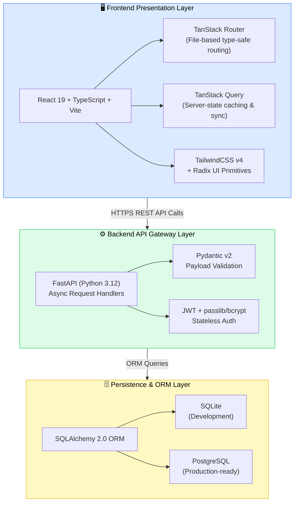
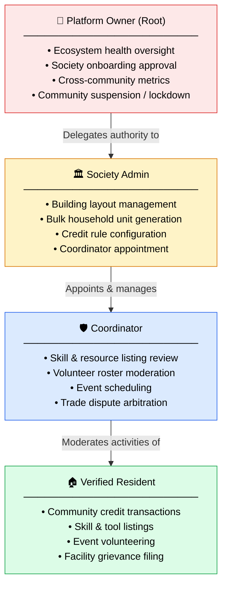
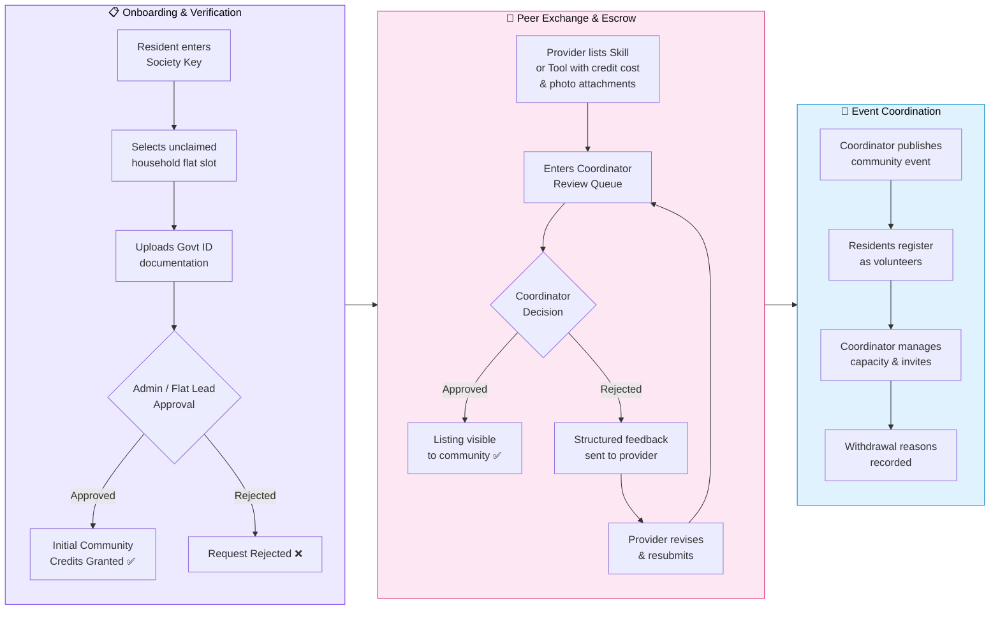
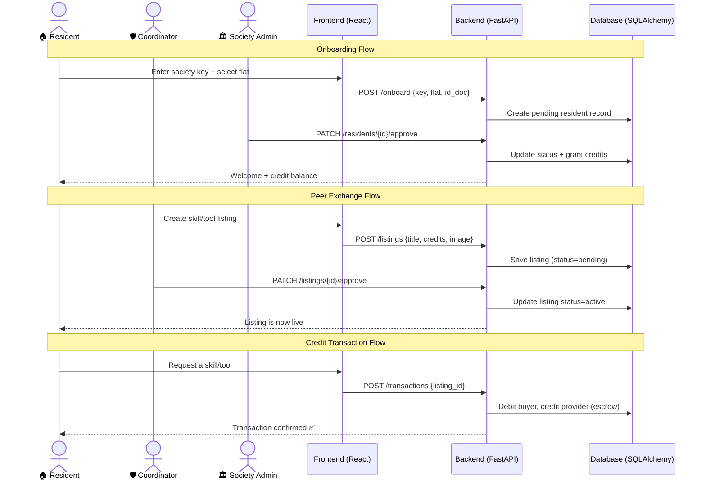

# Proposed Methodology — System Diagrams

---

## Figure 1: Three-Layer System Architecture

---

## Figure 2: Four-Tier Role-Based Access Control (RBAC) Matrix

---

## Figure 3: Modular Workflow and Data Flow

---

## Figure 4: Complete System Data Flow (End-to-End Overview)

